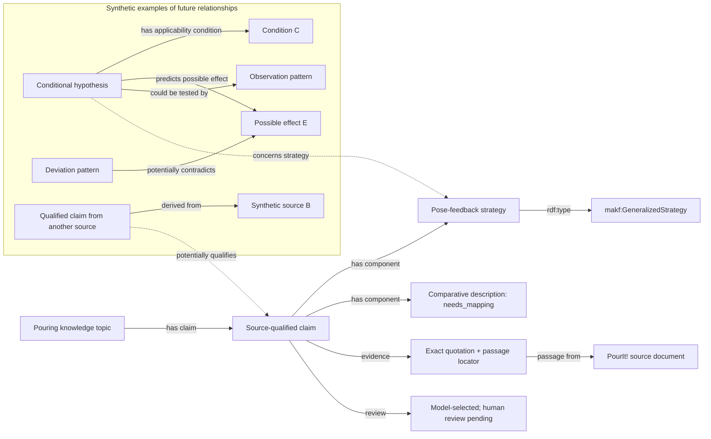

# Proposed final RDF knowledge graph

This is an architecture illustration, not the completed E3 exporter or populated
production graph. [Roadmap](../SYSTEM_ROADMAP.md) describes the remaining work.

## What the graph represents

Ontology modules define reusable classes/properties. The populated graph will
contain identifiable descriptions of claims, strategies, conditions, hypotheses,
evidence anchors and review decisions. These are knowledge-description records;
no individual here denotes a physical robot, container, scene or pouring event.

A claim connects the reusable knowledge content to a specific source and its
qualifications. Several claims may concern the same strategy while retaining
separate conditions, evidence and review status. Hypotheses have explicit possible
effects and applicability conditions; they do not assert that effects occurred.



The source-qualified claim, strategy description, unmapped description, quotation
and review status above are based on the current selected JSON candidate. Their
RDF representation is proposed. Everything in the synthetic section is invented
to demonstrate the design; it is not an extracted scientific result.

## How it grows with more data

- Multiple papers contribute distinct claims with exact citations; agreement does
  not automatically become corroboration or truth.
- Strategies can be compared through associated claims, conditions, goals, phase
  descriptions and reported failure patterns.
- Apparently contradictory claims can remain side by side until their scope and
  conditions are reviewed. `qualifiesClaim` is a proposed publication relation,
  not a currently defined MAKF property or logical negation.
- One source may describe a method while another discusses its limitation. Their
  provenance stays separate rather than being collapsed into an unconditional axiom.
- New hypotheses remain explicitly generated/unassessed and retain the knowledge
  that motivated them, distinct from source-authored assertions.
- Grasping and other action topics reuse MAKF classes while keeping their own
  action frames. Identifying equivalent strategies requires curation; matching
  labels alone must not produce owl:sameAs links.

## Concrete RDF dataset

[final-graph-illustration.trig](final-graph-illustration.trig) is a parseable example
using named graphs (TriG is Turtle syntax with named-graph blocks):

| Named graph | Contents |
| --- | --- |
| `demo:publicationVocabulary` | Proposed claim/evidence/review terms for this illustration |
| `demo:sourceRecords` | The real source metadata and exact locally stored PourIt! excerpt |
| `demo:provisionalCandidate` | A proposed RDF representation of the selected JSON candidate, still provisional |
| `demo:syntheticIllustration` | Invented hypothesis, condition, effect, observation, deviation and second-source example |

`makf:`, `aicor:` and `paf:` refer to existing ontology identifiers. `prov:` refers
to PROV-O. **Every `demo:` term and instance IRI is an illustrative proposal under
`https://example.org/makf-design/`**, not a committed extension of our ontology.
The proposed metadata predicates must be finalized in E3 and validated with SHACL.
The current ontology files have not been altered.

For example, the synthetic hypothesis has this graph structure:

```turtle
demo:hypothesisFeedback a makf:StrategyHypothesis ;
    demo:illustrative true ;
    demo:epistemicStatus "hypothesis" ;
    demo:evidenceStatus "not_assessed" ;
    demo:modality "possible" ;
    makf:concernsStrategy demo:poseFeedbackStrategy ;
    makf:hasApplicabilityCondition demo:conditionC ;
    makf:predictsPossibleEffect demo:effectE ;
    makf:couldBeTestedBy demo:observationO .
```

Its predicates come from MAKF, but the individual hypothesis is a synthetic design
example, not evidence that the condition or predicted effect holds.

## Retrieval and validation

[example-query.rq](example-query.rq) retrieves the actual-source candidate together
with its statement, document and review status. It explicitly selects the source
and candidate graphs, excluding the synthetic graph. Future retrieval must also
apply its intended review-state policy; this example returns a provisional record
for inspection, not an approved fact.

Named graphs organize provenance and trust boundaries; they do not themselves
prove truth or prevent a careless union query from mixing demonstration and real
records. Production graph names, permissions and promotion rules remain to design.

The illustration was parsed successfully with RDFLib: 103 quads. The query returned
one real-source candidate, and both the passage and quotation were checked against
the original JSON. These are syntax, retrieval and fidelity checks only; official
DUL import resolution, OWL consistency, SHACL and production export are pending.
